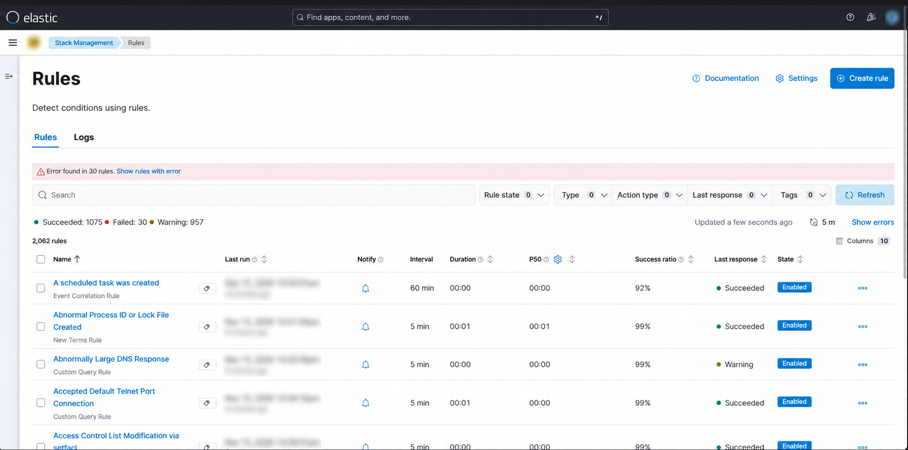
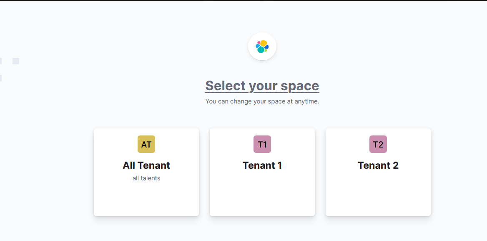
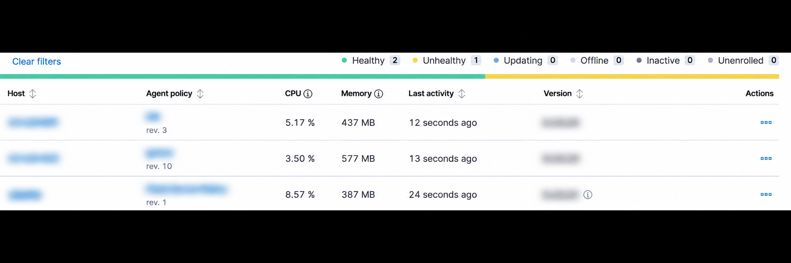

# SIEMEngineing

**A multi-tenant SIEM built on Elasticsearch + Kibana.**

This repository documents a complete, working multi-tenant security-monitoring
deployment: isolated Kibana spaces, Elasticsearch role-based data namespaces,
per-tenant users, the full Elastic prebuilt detection-rule set enabled in every
space, Fleet agents, and a shared read-only **All Tenant** alert view.

It is a lab / reference implementation. The screenshots below are from the live
deployment.

---

## Screenshots

### 2,062 detection rules enabled



The Security → Rules page shows **2,062 rules**, all **Enabled**. At the moment
of capture: **1,075 succeeded**, **30 failed**, **957 warning**. Warnings are
expected because many prebuilt rules target integrations or indices that are not
installed in this lab, and the tenant-space rule copies are deliberately scoped
to tenant data.

### Three spaces: All Tenant, Tenant 1, Tenant 2



Every tenant account sees the shared **All Tenant** space plus exactly its own
space. It never sees another tenant's space.

### Fleet agents enrolled



Three Elastic Agents are enrolled (two healthy, one unhealthy at capture). Each
tenant's agents write to that tenant's data-stream namespace.

---

## What this project demonstrates

| Capability | Implementation |
|------------|----------------|
| Tenant isolation | Kibana space + Elasticsearch index privileges + per-tenant namespace |
| Shared general area | **All Tenant** (`default`) space, read-only for tenants |
| Tenant administration | `space_all` inside the tenant's own space |
| Data separation | `logs-*-<namespace>*`, `metrics-*-<namespace>*`, etc. |
| Alert separation | `.alerts-security.alerts-<space-id>*` per space |
| Cross-tenant alert view | Default space's global rule set writes to the shared Default alert index; tenants have read-only access |
| Detection rules | `security_detection_engine` 8.19.37; 2,062 installable on Basic; all enabled in all three spaces |
| Rule API-key safety | Tenant-space rules installed/enabled by the tenant user, so their API keys are tenant-scoped |
| Verification | 53/53 isolation checks, 15/15 rule checks, login/negative-auth checks |
| Repeatability | Step-by-step runbooks, scripts, and raw evidence |

---

## Architecture

```
                         ┌─────────────────────────────────────────────┐
                         │              Elasticsearch                   │
                         │              cluster grcico.SIEM             │
                         │                                             │
  T1_user ──role──►     │  logs-*-greencircle*   metrics-*-greencircle*│
  (Tenant 1)             │  traces-*-greencircle* synthetics-*-...      │
                         │  grc-*                                       │
                         │  .alerts-security.alerts-grcico-com*         │
                         │                                             │
  T2_user ──role──►     │  logs-*-tkt*   metrics-*-tkt*                │
  (Tenant 2)             │  traces-*-tkt* synthetics-*-tkt*             │
                         │  tkt-*                                       │
                         │  .alerts-security.alerts-tkt-org*            │
                         └─────────────────────────────────────────────┘

                         ┌─────────────────────────────────────────────┐
                         │                 Kibana                       │
                         │  Space default     ◄── all tenants (read)    │
                         │      "All Tenant"      shared alerts + rules │
                         │  Space grcico-com  ◄── grc_user (space_all)  │
                         │      "Tenant 1"                              │
                         │  Space tkt-org     ◄── tkt_user  (space_all) │
                         │      "Tenant 2"                              │
                         └─────────────────────────────────────────────┘
```

### The three isolation layers

1. **Elasticsearch index privileges** — each role names only its tenant's
   index/data-stream patterns. Elasticsearch refuses everything else.
2. **Kibana space privileges** — `space_all` on exactly one tenant space and
   `space_read` on the shared `default` space. The other tenant's space is
   invisible and returns `403`.
3. **Per-space data views** — the tenant space only contains data views whose
   titles match that tenant's namespace.

Detection rules add a fourth layer: rules installed and enabled by a tenant user
get an API key scoped to that tenant's role, so a tenant cannot turn a rule into
a cross-tenant data reader.

---

## Final results

| Item | Value |
|------|-------|
| Kibana / Elasticsearch | 8.19.24 |
| License | Basic (active) |
| Cluster | `grcico.SIEM` / `node-1` |
| Spaces | `default` (All Tenant), `grcico-com` (Tenant 1), `tkt-org` (Tenant 2) |
| Detection package | `security_detection_engine` 8.19.37 |
| Rules per space | 2,062 (of 2,157 packaged; 95 need a higher license) |
| Rules enabled per space | **2,062 / 2,062** |
| Detection-engine API keys | **6,236** |
| Isolation suite | **53 / 53 PASS** |
| Rule suite | **15 / 15 PASS** |
| Default alert index | 2 alerts at capture |
| Tenant alert indices | own alerts only (e.g. `tkt-org` 1 at capture) |
| Cluster health | yellow (single node, unassigned replicas — expected) |

> **Enabled is not the same as healthy.** Many rules report `warning`/`failed`
> because the matching integration or index is not installed, or because a
> tenant-scoped rule API key cannot read indices outside the tenant namespace.
> That is the isolation model working as designed. It is not a data leak.

---

## End-to-end integration guide

The commands below use placeholders. Set them once per shell:

```bash
ES='http://<ELASTIC_HOST>:9200'
KB='http://<ELASTIC_HOST>:5601'
ADMIN='elastic:<ADMIN_PASSWORD>'
X='kbn-xsrf: true'
J='Content-Type: application/json'
```

The lab used `192.168.1.212` for both services. Do not reuse lab passwords; see
[`docs/credentials-test-only.md`](docs/credentials-test-only.md) (placeholders
only).

---

### Phase 0 — Prerequisites

- Two hosts or VMs (or one lab VM) with Elasticsearch and Kibana 8.19.x.
- A license that supports the detection engine. The lab uses **Basic**; 2,062 of
  the 2,157 packaged rules are installable.
- Administrator access to both APIs.
- Fleet Server if you want agents; the lab uses one Fleet Server with
  per-tenant agent policies and namespaces.
- A naming decision for each tenant:

| Identifier | Example | Used for |
|------------|---------|----------|
| Space ID | `acme` | Kibana space, alert index suffix |
| Namespace | `acme` | data-stream suffix |
| Role | `Acme` | Elasticsearch role |
| User | `acme_user` | Kibana/Elasticsearch login |

---

### Phase 1 — Install and verify the stack

Install Elasticsearch and Kibana 8.19.x using the official packages (or Docker).
Then verify:

```bash
curl -s -u "$ADMIN" "$ES/_cluster/health?pretty"
curl -s -o /dev/null -w '%{http_code}\n' -u "$ADMIN" "$KB/api/status"
```

Expected: cluster health JSON (yellow is normal on a single node) and Kibana
`200`.

> The rest of this guide assumes Elasticsearch and Kibana are already running and
> reachable over HTTP on the lab network. Put TLS in front of both before any
> real use.

---

### Phase 2 — Fix Kibana encryption keys (critical)

The detection engine stores encrypted saved objects (rules, API keys,
connectors). If the three Kibana encryption keys are missing, rule APIs return
`404`/errors and rules cannot be created or run.

Add three random keys to `/etc/kibana/kibana.yml`:

```yaml
xpack.encryptedSavedObjects.encryptionKey: "<32-byte-random-hex>"
xpack.reporting.encryptionKey: "<32-byte-random-hex>"
xpack.security.encryptionKey: "<32-byte-random-hex>"
```

Then restart Kibana:

```bash
sudo systemctl restart kibana
```

Verify `/api/status` is `available` and the detection-rules API returns `200`
instead of `404`:

```bash
curl -s -o /dev/null -w '%{http_code}\n' -u "$ADMIN" -H "$X" \
  "$KB/api/detection_engine/rules/_find?per_page=1"
```

The helper `tools/fix_kibana_keys.sh` does this.

---

### Phase 3 — Plan tenants and namespaces

For each tenant, decide:

- **Space ID** — lowercase, dash-friendly. Example: `acme`.
- **Namespace** — the Fleet/data-stream suffix. Example: `acme`.
- **Role name** — example: `Acme`.
- **Username** — example: `acme_user`.

The namespace must appear in every data stream:

```
logs-<dataset>-<namespace>
metrics-<dataset>-<namespace>
traces-<dataset>-<namespace>
synthetics-<dataset>-<namespace>
profiling-<dataset>-<namespace>
```

The tenant can also have a custom index pattern such as `<namespace>-*`.

> The lab mapping is: Tenant 1 = `grcico-com` / `greencircle` / `GreenCircle` /
> `grc_user`; Tenant 2 = `tkt-org` / `tkt` / `tkt` / `tkt_user`.

---

### Phase 4 — Create the Kibana spaces

```bash
curl -s -u "$ADMIN" -H "$X" -H "$J" -X POST "$KB/api/spaces/space" -d '{
  "id": "acme",
  "name": "Acme Corp",
  "description": "Acme tenant space",
  "initials": "AC",
  "color": "#9170B8",
  "disabledFeatures": []
}'
```

Repeat for each tenant. Keep `default` as the shared **All Tenant** space.

Verify:

```bash
curl -s -u "$ADMIN" -H "$X" "$KB/api/spaces/space"
```

---

### Phase 5 — Create the tenant roles

Save the JSON below as `role.json`, replacing `<SPACE_ID>` and `<NAMESPACE>`.
This is the exact permission model used in the lab.

```json
{
  "cluster": [],
  "indices": [
    {
      "names": [
        "logs-*-<NAMESPACE>*",
        "metrics-*-<NAMESPACE>*",
        "traces-*-<NAMESPACE>*",
        "synthetics-*-<NAMESPACE>*",
        "profiling-*-<NAMESPACE>*"
      ],
      "privileges": ["all"],
      "allow_restricted_indices": false
    },
    {
      "names": ["<NAMESPACE>-*"],
      "privileges": ["all"],
      "allow_restricted_indices": false
    },
    {
      "names": [
        ".alerts-security.alerts-<SPACE_ID>*",
        ".internal.alerts-security.alerts-<SPACE_ID>*"
      ],
      "privileges": ["all"],
      "allow_restricted_indices": true
    },
    {
      "names": [
        ".alerts-security.alerts-default*",
        ".internal.alerts-security.alerts-default*"
      ],
      "privileges": ["read", "view_index_metadata"],
      "allow_restricted_indices": true
    }
  ],
  "applications": [
    {
      "application": "kibana-.kibana",
      "privileges": ["space_all"],
      "resources": ["space:<SPACE_ID>"]
    },
    {
      "application": "kibana-.kibana",
      "privileges": ["space_read"],
      "resources": ["space:default"]
    }
  ],
  "description": "Tenant <SPACE_ID>: full read/write on its namespace and alert indices; read-only in the shared Default space and its alerts."
}
```

Apply:

```bash
curl -s -u "$ADMIN" -H "$J" -X PUT "$ES/_security/role/<ROLE_NAME>" -d @role.json
```

**Why each block matters**

| Block | Purpose |
|-------|---------|
| Own data streams + `<namespace>-*` | Full read/write inside the tenant only |
| Own alert indices | Full alert management inside the tenant only |
| Default alert indices, `read` | Shared all-tenant alert view, no writes |
| `space_all` on own space | Tenant can create dashboards, rules, etc. |
| `space_read` on `default` | Shared read-only general area |
| `"cluster": []` | No cluster health, security API, or index management |

> Never grant `cluster` privileges or broad `logs-*` / `metrics-*` access to a
> tenant role. That is what caused the original over-permissioning in the lab.

---

### Phase 6 — Create the tenant users

```bash
curl -s -u "$ADMIN" -H "$J" -X POST "$ES/_security/user/<USERNAME>" -d '{
  "password": "<TENANT_PASSWORD>",
  "roles": ["<ROLE_NAME>"],
  "metadata": { "tenant": "<NAMESPACE>" }
}'
```

Verify the role is attached:

```bash
curl -s -u "$ADMIN" "$ES/_security/user/<USERNAME>"
```

---

### Phase 7 — Create the tenant data views

Create them inside the tenant space, as the tenant user:

```bash
for pair in \
  "logs-*-<NAMESPACE>*|<TENANT> Logs" \
  "metrics-*-<NAMESPACE>*|<TENANT> Metrics" \
  "<NAMESPACE>-*|<TENANT> Custom"; do
  TITLE="${pair%%|*}"
  NAME="${pair##*|}"
  curl -s -u "<USERNAME>:<TENANT_PASSWORD>" -H "$X" -H "$J" \
    -X POST "$KB/s/<SPACE_ID>/api/data_views/data_view" -d "{
      \"data_view\": {
        \"title\": \"$TITLE\",
        \"name\": \"$NAME\",
        \"timeFieldName\": \"@timestamp\"
      },
      \"override\": true
    }"
  echo
done
```

Do **not** create broad `logs-*` / `metrics-*` data views in the tenant space.
They would be filtered by Elasticsearch anyway, but narrow views are clearer and
faster.

---

### Phase 8 — Install Fleet and enroll agents

1. Open **Fleet** in Kibana.
2. Create one **agent policy per tenant** and set its namespace to the tenant's
   namespace (e.g. `acme`).
3. Enroll each tenant's agents with that policy.
4. Confirm the agents write to `logs-<dataset>-<namespace>` and
   `metrics-<dataset>-<namespace>`.

The lab uses one Fleet Server with three agents; see the Fleet screenshot.

> Keep Fleet policies per tenant. A shared policy with the wrong namespace would
> mix data streams and break the isolation model.

---

### Phase 9 — Install the detection-rules package

Kibana may install `security_detection_engine` automatically. To force it:

```bash
curl -s -u "$ADMIN" -H "$X" -H "$J" \
  -X POST "$KB/api/fleet/epm/packages/security_detection_engine" \
  -d '{"force":true}'
```

Check the version and status:

```bash
curl -s -u "$ADMIN" -H "$X" \
  "$KB/api/fleet/epm/packages/security_detection_engine"
```

On the lab: **8.19.37 / installed**, 2,157 rules packaged, 2,062 installable on
Basic.

---

### Phase 10 — Install the prebuilt rules in every space

Install **as the space's user**. For `default`, use `elastic` (global API keys
for the shared view). For a tenant space, use the tenant user (tenant-scoped API
keys).

```bash
# Default / All Tenant: global rule set
curl -s -u "$ADMIN" -H "$X" -H "$J" \
  -X POST "$KB/s/default/internal/detection_engine/prebuilt_rules/installation/_perform" \
  -d '{"mode":"ALL_RULES"}'

# Tenant space: as the tenant user
curl -s -u "<USERNAME>:<TENANT_PASSWORD>" -H "$X" -H "$J" \
  -X POST "$KB/s/<SPACE_ID>/internal/detection_engine/prebuilt_rules/installation/_perform" \
  -d '{"mode":"ALL_RULES"}'

# Upgrade outdated rules in the same space
curl -s -u "<USERNAME>:<TENANT_PASSWORD>" -H "$X" -H "$J" \
  -X POST "$KB/s/<SPACE_ID>/internal/detection_engine/prebuilt_rules/upgrade/_perform" \
  -d '{"mode":"ALL_RULES"}'
```

A fresh 2,062-rule install takes about **2 minutes** per space.

> If you install tenant rules as `elastic`, their API keys can read every index
> and the isolation guarantee is lost. Always install tenant copies as the tenant
> user.

---

### Phase 11 — Enable all rules

Kibana caps a bulk action at **100 rule ids**. The helper script handles the
chunking:

```bash
python tools/enable_all_rules_http.py default
python tools/enable_all_rules_http.py grcico-com
python tools/enable_all_rules_http.py tkt-org

# Generic new tenant:
python tools/enable_all_rules_http.py acme --user acme_user --password '<TENANT_PASSWORD>'
```

The script fetches only disabled rules and sends:

```json
{"action":"enable","ids":["<id1>","<id2>", "..."]}
```

Expected final line:

```
=== DONE acme: enabled=2062 batch_failed=0 elapsed=... ===
```

The API also accepts a query form:

```json
{"action":"enable","query":"alert.attributes.name:\"...\""}
```

> Sending more than 100 ids returns
> `"More than 100 ids sent for bulk edit action."` and rejects the batch.

---

### Phase 12 — Share the Default space and alerts (read-only)

The `default` space is the **All Tenant** area:

- tenants have `space_read` on `space:default`;
- tenants have `read` + `view_index_metadata` on
  `.alerts-security.alerts-default*` and
  `.internal.alerts-security.alerts-default*`;
- tenants cannot create, edit, delete, acknowledge, or close anything in Default.

The Default space has its own **global** rule set (enabled by `elastic`). Its API
keys can read all tenant data, so it writes cross-tenant alerts to the Default
alert index. That is how **All Tenant → Security → Alerts** shows every tenant's
alerts without exposing raw tenant indices.

Verify from a tenant account:

```bash
# Default space readable
curl -s -o /dev/null -w '%{http_code}\n' -u "<USERNAME>:<TENANT_PASSWORD>" -H "$X" \
  "$KB/s/default/api/saved_objects/_find?type=dashboard"

# Default alerts readable
curl -s -o /dev/null -w '%{http_code}\n' -u "<USERNAME>:<TENANT_PASSWORD>" \
  "$ES/.internal.alerts-security.alerts-default-000001/_search"

# Default alerts NOT writable
curl -s -o /dev/null -w '%{http_code}\n' -u "<USERNAME>:<TENANT_PASSWORD>" -H "$J" \
  -X POST "$ES/.alerts-security.alerts-default/_doc" -d '{"test":1}'
```

Expected: `200`, `200`, `403`.

---

### Phase 13 — Verify everything

Run the three suites from the Windows workstation (the scripts use
`tools/remote_exec.py` to upload to the lab VM; adapt the host variables for your
environment):

```powershell
$env:PYTHONIOENCODING="utf-8"
python tools\remote_exec.py tools\verify_isolation_final.sh /tmp/verify.sh "bash /tmp/verify.sh"
python tools\remote_exec.py tools\dr_verify_isolation.sh /tmp/dr_verify.sh "bash /tmp/dr_verify.sh"
python tools\remote_exec.py tools\verify_login.sh /tmp/login.sh "bash /tmp/login.sh"
```

Expected on the lab:

- `verify_isolation_final.sh`: **PASS=53 FAIL=0**
- `dr_verify_isolation.sh`: **PASS=15 FAIL=0**
- Login: both users log in, land on the space selector, see `default` + own
  space, foreign space `403`, bad password `401`.

The suites cover:

1. Elasticsearch read/write isolation (own vs other data streams).
2. Wildcard namespace isolation (0 hits for foreign data).
3. Alert-index isolation + shared Default alert read/write denial.
4. Space-list visibility.
5. Cross-space saved objects (read and write).
6. Privilege escalation (security users, cluster health, index creation).
7. Detection-rule isolation and enabled counts (2,062 per space).
8. Login/redirect/negative-auth checks.

Full details: [`docs/05-verification-evidence.md`](docs/05-verification-evidence.md).

---

### Phase 14 — Add another tenant

Use the dedicated step-by-step runbook:

**[`docs/11-add-new-tenant.md`](docs/11-add-new-tenant.md)**

It covers:

1. choosing space/namespace/role/user names;
2. creating the space;
3. creating the role with the exact JSON;
4. creating the user;
5. creating data views;
6. installing prebuilt rules as the tenant user;
7. enabling all rules in batches of 100;
8. making the Default space show the new tenant's alerts;
9. verifying data, space, rule, and alert isolation;
10. recording and maintaining the tenant;
11. removing a tenant safely.

---

### Phase 15 — Operate and maintain

| Event | Action |
|-------|--------|
| Kibana / detection-package upgrade | Re-run install + upgrade, then enable all rules. Package upgrades can remove tenant-space rule copies. |
| New tenant | Follow `docs/11-add-new-tenant.md`. |
| New data source | Enroll agents with the tenant's namespace; never reuse another tenant's namespace. |
| Noisy rule | Disable or tune it in that tenant's space only. Check the shared Default rule set separately. |
| Default alerts empty | Check Default rule execution; confirm data uses standard `logs-<dataset>-<namespace>` names. |
| Rule shows `warning`/`failed` | Check the expected integration/index, or the tenant-scoped API-key warning. Expected in the lab. |
| Tenant leaves | Delete user, role, space, data streams, alert indices after export. |
| Cluster yellow | Single-node lab with unassigned replicas; expected. |

---

## Verification results

### Isolation suite — 53/53

```
PASS  grc_user READ own data stream (expected 200, got 200)
PASS  grc_user READ other data stream (0 hits) (expected 0, got 0)
PASS  grc_user WRITE own data stream (expected 201, got 201)
PASS  grc_user WRITE other data stream (403) (expected 403, got 403)
...
PASS  grc_user blocked from tkt alert index (expected 403, got 403)
PASS  grc_user can READ shared default alerts (expected 200, got 200)
PASS  grc_user cannot WRITE shared default alerts (expected 403, got 403)
PASS  grc_user can search default alerts in Kibana (expected 200, got 200)
...
PASS=53 FAIL=0
```

### Rule suite — 15/15

```
PASS  default space has all 2062 rules enabled (expected 2062, got 2062)
PASS  grcico-com space has all 2062 rules enabled (expected 2062, got 2062)
PASS  tkt-org space has all 2062 rules enabled (expected 2062, got 2062)
PASS  grc_user can query own space rules (expected 200, got 200)
PASS  grc_user blocked from tkt rules (403) (expected 403, got 403)
PASS  grc_user can READ shared default rules (expected 200, got 200)
...
PASS=15 FAIL=0
```

Raw evidence:

- [`docs/evidence/06-isolation-verification.txt`](docs/evidence/06-isolation-verification.txt)
- [`docs/evidence/07-login-flow-verification.txt`](docs/evidence/07-login-flow-verification.txt)
- [`docs/evidence/11-detection-rules-verification.txt`](docs/evidence/11-detection-rules-verification.txt)
- [`docs/evidence/12-rules-enabled-state.txt`](docs/evidence/12-rules-enabled-state.txt)

---

## Repository layout

```
SIEMEngineing/
├─ README.md                     # this end-to-end guide
├─ screenshots/
│  ├─ 01-rules-enabled.png       # 2,062 enabled rules
│  ├─ 02-space-selector.png      # All Tenant / Tenant 1 / Tenant 2
│  └─ 03-fleet-agents.png        # Fleet agents
├─ docs/
│  ├─ 01-inventory.md            # machine, stack, services, ports
│  ├─ 02-baseline-before-changes.md
│  ├─ 03-tenant-design.md        # isolation architecture + role JSON
│  ├─ 04-provisioning-runbook.md
│  ├─ 05-verification-evidence.md
│  ├─ 06-operations-guide.md
│  ├─ 07-hardening-checklist.md
│  ├─ 08-change-log.md
│  ├─ 09-raw-evidence-index.md
│  ├─ 10-detection-rules.md
│  ├─ 11-add-new-tenant.md       # new-tenant step-by-step
│  ├─ credentials-test-only.md   # placeholders only
│  └─ evidence/                  # raw UTF-8 command output
└─ tools/                        # audit, provisioning, verification scripts
```

---

## Documentation

Start with [`docs/README.md`](docs/README.md). The most important documents:

| Document | What it answers |
|----------|-----------------|
| [`docs/03-tenant-design.md`](docs/03-tenant-design.md) | How isolation works and the exact role JSON |
| [`docs/04-provisioning-runbook.md`](docs/04-provisioning-runbook.md) | How the tenants were provisioned |
| [`docs/05-verification-evidence.md`](docs/05-verification-evidence.md) | Every test and its expected/got result |
| [`docs/06-operations-guide.md`](docs/06-operations-guide.md) | Day-to-day tenant usage |
| [`docs/10-detection-rules.md`](docs/10-detection-rules.md) | Rule install, enablement, failures, recovery |
| [`docs/11-add-new-tenant.md`](docs/11-add-new-tenant.md) | Add a tenant with identical permissions |

---

## Security notes

This is a **lab reference**, not a production-hardened deployment.

- **No real credentials are in this repository.** All passwords, keys, and
  tokens were replaced with placeholders. `docs/credentials-test-only.md`
  contains placeholders only.
- The lab used plain HTTP on a private LAN. Put TLS in front of Elasticsearch and
  Kibana before any real use.
- Rotate every lab credential and move `kibana_system` into the Kibana keystore.
- Move SSH to key-only authentication.
- The Basic license limits some advanced security features and 95 of the 2,157
  packaged rules.
- The single-node cluster has unassigned replicas by design; cluster health is
  yellow.
- Enabling 6,186 rule instances (2,062 × 3 spaces) on one node is heavy. Many
  rules will warn/fail because the matching integration is absent or because
  tenant-scoped API keys cannot read other tenants' indices.
- Do not publish a filled-in copy of `docs/credentials-test-only.md`.

---

## Known limitations

| Limitation | Impact / mitigation |
|------------|---------------------|
| Single shared cluster and node | No resource isolation between tenants; a noisy tenant can affect others. Use per-tenant ILM, shard limits, and monitoring. |
| Basic license | Some advanced rule actions and DLS/FLS workflows are unavailable; 95 packaged rules are skipped. |
| No ingest-time `tenant` field | Namespace isolation is the control. If tenants must share an index, add a mandatory `tenant` field and revisit DLS. |
| Duplicate rule computation | The Default global rule set and the tenant-space copies both run. Accepted in this lab for the shared alert view. |
| Tenant rule warnings | Tenant-scoped rule API keys cannot read broad prebuilt patterns outside the tenant namespace. Expected. |
| Package auto-upgrades | Kibana can upgrade `security_detection_engine` and remove tenant-space rule copies. Re-run install + enable after upgrades. |
| Scheduler load | 6,186 rule instances on one node; rules are staggered and some show `never` until their first scheduled run. |

---

## License

MIT — see [`LICENSE`](LICENSE).

---

## Acknowledgements

Built on [Elasticsearch](https://www.elastic.co/elasticsearch/),
[Kibana](https://www.elastic.co/kibana/), and the
[Elastic detection-rules](https://github.com/elastic/detection-rules) corpus.
